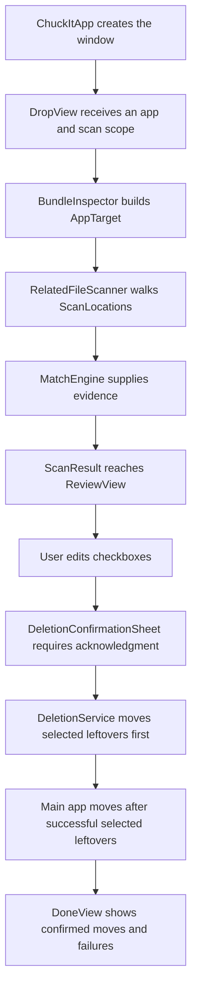

# How Chuckit is built

Notes signed **RFO2**.

## Start here

**RFO2 —** Chuckit is a native macOS app written in Swift and SwiftUI. AppKit supplies the open panel, application metadata, Finder integration and native Trash operation. The main app and its WidgetKit extension are separate Xcode targets. The app source has one canonical home: `chuckit/`.

Read `ChuckItApp.swift`, then `ContentView.swift`, then the service used by the phase you are interested in. The `RFO2 —` notes beside important declarations explain their purpose and constraints. The user-facing README describes usage; this guide describes construction.

## The complete path through the app

**RFO2 —** A scan and an uninstall are separate operations. Selecting an application starts an investigation. Only the confirmed checkbox selection starts a Trash operation.



**RFO2 —** `Phase` in `ContentView.swift` carries the data for the current screen. It has drop, scanning, review, deleting and done states. The child views receive callbacks rather than reaching directly into one another. This keeps the transition logic in one place.

## File map

**RFO2 —** These files are responsibilities, not alternate implementations. Change the canonical file and run the build/tests; there are no root-level Swift mirrors to synchronize.

| File | Responsibility |
| --- | --- |
| `chuckit/ChuckItApp.swift` | Creates the window, applies its icon and receives the widget open URL. |
| `chuckit/ContentView.swift` | Coordinates phases and contains scan progress, Trash progress and outcome screens. |
| `chuckit/DropView.swift` | Receives URLs, provides Browse, validates the drive and chooses scan scope. |
| `chuckit/BundleInspector.swift` | Reads bundle identity, signing-team metadata, app groups and embedded helper IDs. |
| `chuckit/Models.swift` | Defines `AppTarget`, `RelatedFile` and `ScanResult`. |
| `chuckit/ScanLocations.swift` | Defines the roots for normal and wider search modes. |
| `chuckit/RelatedFileScanner.swift` | Traverses eligible roots, asks for evidence, estimates sizes and reports progress. |
| `chuckit/MatchEngine.swift` | Produces identifier, group, name and metadata evidence. |
| `chuckit/RemovalPolicy.swift` | Defines internal startup-volume eligibility and shared path/removal rules. |
| `chuckit/ReviewView.swift` | Owns editable checkbox state and snapshots the confirmed selection. |
| `chuckit/DeletionConfirmationSheet.swift` | Requires acknowledgment for this particular removal attempt. |
| `chuckit/DeletionNotice.swift` | Holds the shared confirmation wording. |
| `chuckit/DeletionService.swift` | Coordinates quitting, deduplication, native recycling, Finder fallback and receipts. |
| `chuckit/FullDiskAccessSetup.swift` | Explains access/removal permissions and opens the corresponding settings. |
| `chuckit/SearchingCan.swift` | Selects numbered mascot frames from elapsed animation time. |
| `chuckit/Wordmark.swift` | Shares the wordmark and screen palette. |
| `ChuckitWidget/ChuckitWidget.swift` | Displays a static mascot and opens the main app. |
| `Tests/RegressionTests.swift` | Runs disposable-fixture checks with an injected recycler. |
| `Tests/run-tests.sh` | Compiles the canonical service files and starts the regression executable. |

## Data and matching

**RFO2 —** `AppTarget` holds the selected URL and identity metadata. Embedded helper IDs and application groups come from the bundle and code signature. The signing team is recorded, but the current matcher does not use a shared signing team to authorize selecting another file.

**RFO2 —** `MatchEngine.Evidence` separates the explanation from the initial checkbox suggestion. Known app/helper identifiers are stronger evidence. A shared app group or a display-name match needs user review. The scanner then combines that evidence with the location and scope to build `RelatedFile` rows. Matching is a heuristic, not a guarantee of exclusive ownership.

**RFO2 —** `ReviewView` copies `ScanResult.files` into local `State`. Checkboxes modify that local copy. A `DeletionSelection` captures the rows for one confirmation sheet, so the displayed count and submitted selection come from the same snapshot. Returning from confirmation preserves the review list.

## Threads and cancellation

**RFO2 —** `RelatedFileScanner` publishes UI state on the main actor and performs directory traversal in a detached task. Its `scanID` discards progress updates from older scans. Traversal checks cancellation between roots and entries. `ContentView` also checks cancellation before showing a scan result.

**RFO2 —** Native AppKit recycling and Finder Apple Events run on the main actor. A checked continuation bridges the native recycle callback into the asynchronous service. `DeleteProgressBridge` sends progress back to SwiftUI without putting published UI state on a background thread.

**RFO2 —** The current scan ID protects progress, but it does not fully serialize multiple application drops; comments should describe the implemented guarantee, not a stronger one.

## Drive and removal boundaries

**RFO2 —** `InternalDrivePolicy` accepts only the internal startup volume and its APFS Data counterpart. It checks the supplied path, its resolved location and its volume identity. Enumeration checks volume identity again because a mounted directory can sit inside an otherwise eligible root. The same boundary applies to discovery, sizing and removal.

**RFO2 —** `RemovalPolicy` prevents moving broad shared folders, Chuckit itself, its containing folders and unsafe redirected paths. The policy is checked during candidate discovery and again before each removal attempt. A result found earlier is not an enduring authorization: files and paths can change during review or an operating-system prompt.

**RFO2 —** The service politely asks the app and known helpers to quit, waits briefly, and stops if they remain running. A selected directory covers its children, so overlapping selections are collapsed. Selected leftovers move before the main app. If a selected leftover fails, the main app is kept; already successful moves remain in Trash.

**RFO2 —** `NSWorkspace.recycle` is tried first. A permission refusal can send only still-present, unconfirmed items to Finder. User cancellation does not trigger fallback. Finder receives a path as an Apple Event argument rather than interpolated script text, and Finder owns any administrator prompt. Chuckit never receives the password.

**RFO2 —** A confirmed receipt requires the original to be absent and the reported destination to exist in internal Trash. Only a no-such-file error means absence. An access or metadata error cannot prove success.

## Art, animation and widget

**RFO2 —** The main app's `Assets.xcassets` supplies its icon, drop-screen can and 22 numbered `ChuckActivity` images. `SearchingCan` maps elapsed time into the duration array. Index N corresponds to `ChuckActivityN`. Keeping that mapping intact avoids jumps when the mascot artwork changes. Reduce Motion pauses the timeline and selects a fixed pose.

**RFO2 —** The widget has a separate asset catalog because it is packaged as its own extension. Repeated filenames such as `Contents.json` and `Info.plist` describe different resources or targets; they are required files. They are not redundant Swift source copies.

**RFO2 —** The widget's never-refresh timeline displays static content. Its `chuckit://open` link is registered in `ChuckitInfo.plist` and handled in `ChuckItApp`. Opening the app never selects files or starts removal. The app has an Apple Events entitlement; the widget has its own sandbox entitlement.

## Build and verify

**RFO2 —** Open `chuckit.xcodeproj` from the repository root with Xcode 27 or later. Use the shared `chuckit` scheme and My Mac destination. The current deployment target is macOS 27.0. Choose your signing team for your own builds. `ChuckitInfo.plist` and `Chuckit.entitlements` are configuration inputs at the repository root.

```sh
bash Tests/run-tests.sh
```

**RFO2 —** An optional first argument places regression output in another writable directory. The script builds services directly from `chuckit/`; it does not compile a second source set. Fixtures have unique temporary roots. The injected recycler simulates recoverable moves, failures and cancellation without uninstalling real applications.

**RFO2 —** Fixture checks complement a native Xcode build and live UI checks. Finder authorization, actual operating-system prompts and recovery from real Trash operations need separate integration validation. Passing fixtures is not a claim that every matching or Finder receipt edge case is solved.

## Repository maintenance

**RFO2 —** The project, source, tests, README and license now share one Git root. Keep generated test/build output and local Xcode session files out of Git. The shared scheme belongs in Git; `xcuserdata` does not. The folder consolidation preserved existing history and staged work, with a full backup outside this repository.

**RFO2 —** Before a public app release, validate a distribution build. Publishing source to GitHub and shipping a signed, notarized application are separate milestones. The LICENSE retains the owner's usage terms; this cleanup does not change them.
